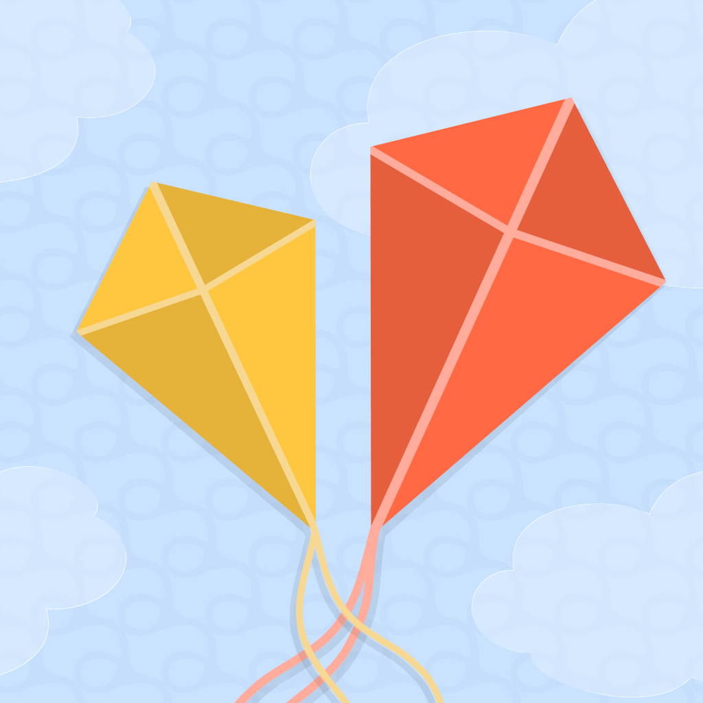
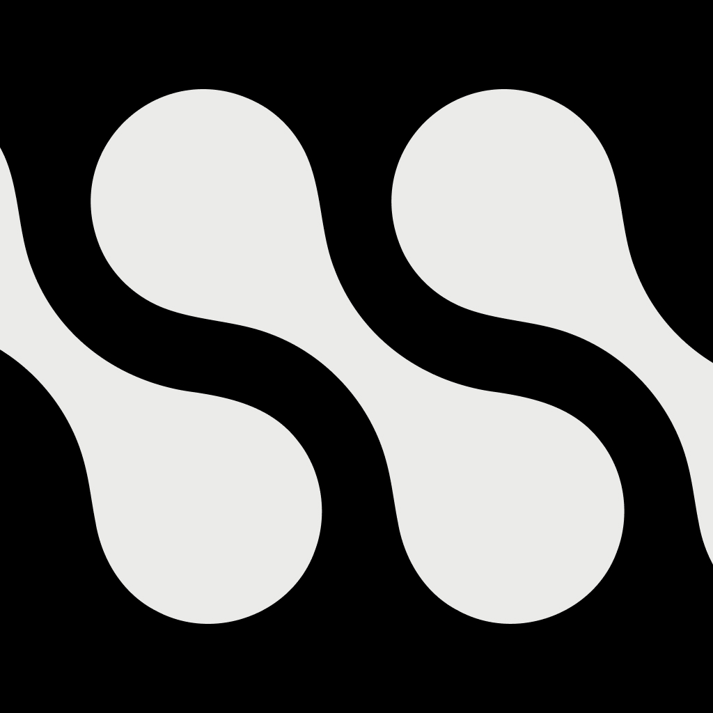
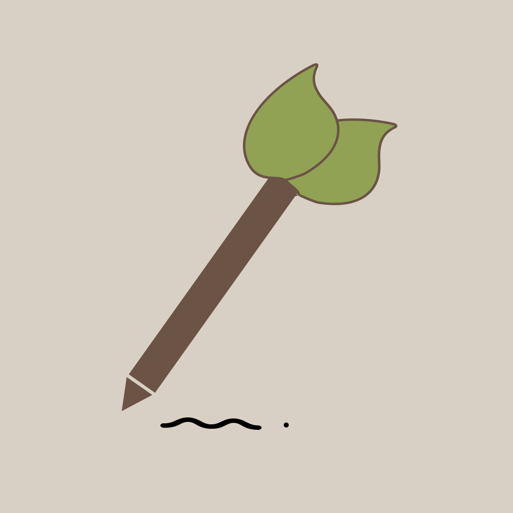
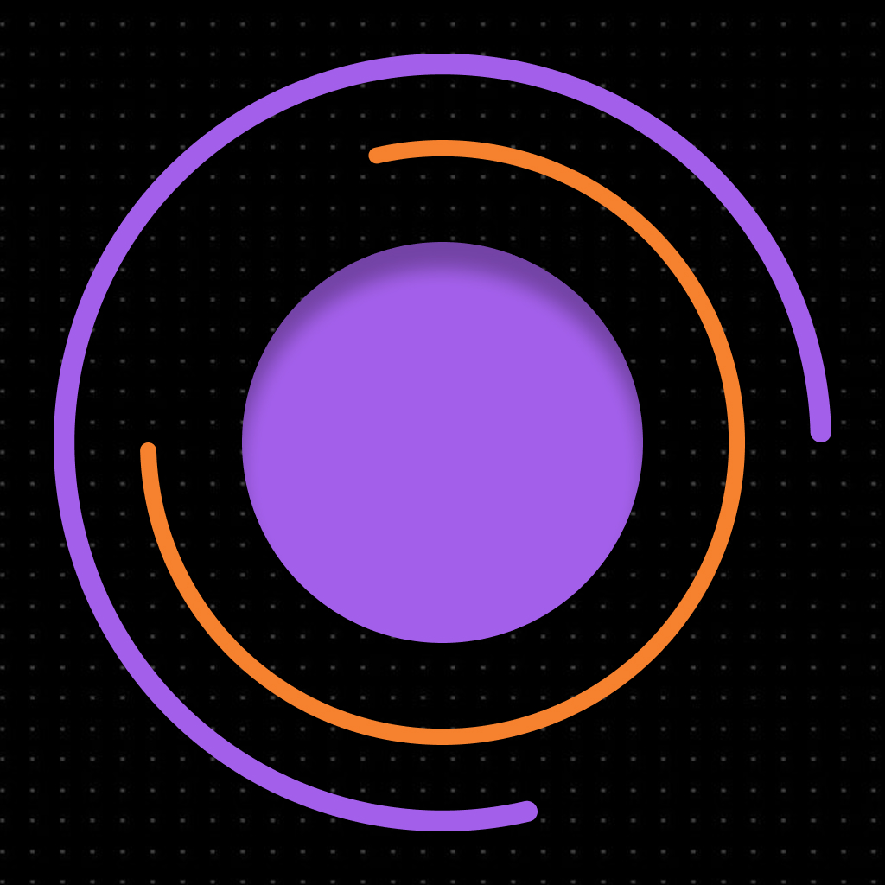
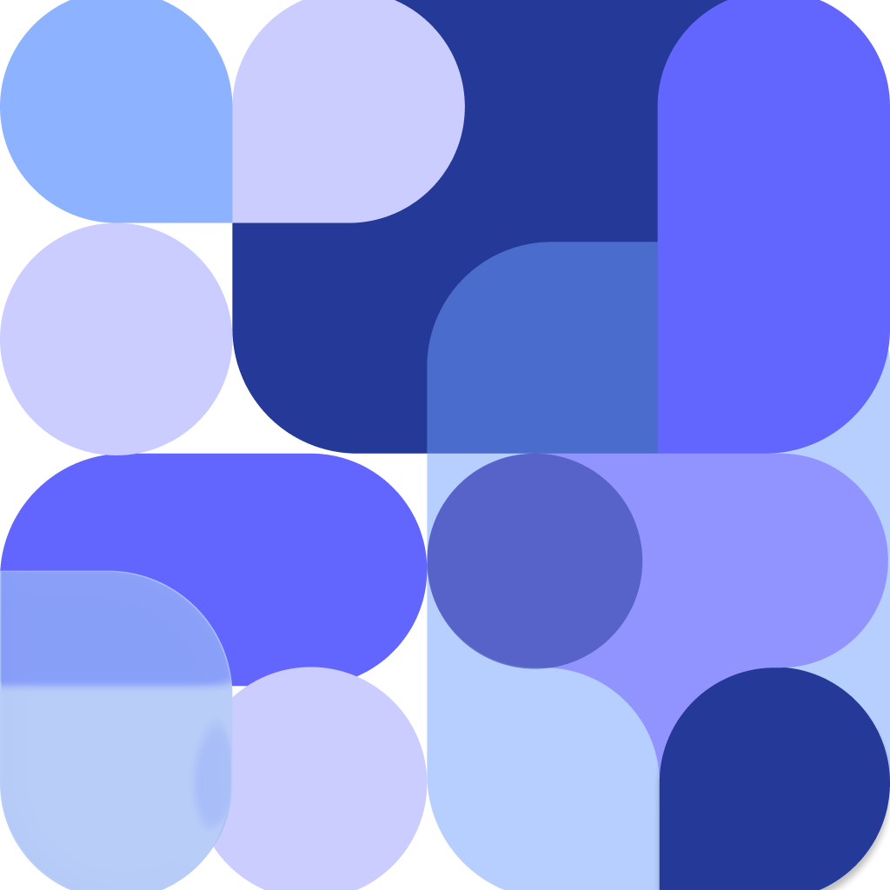

### 👋 Hi, I'm Anshu!

**iOS Developer · Information Systems Student at Mackenzie · Apple Developer Academy**

I build iOS apps from the idea to the App Store, solo and in teams. 
Also interested in **Cloud, Backend, Data and AI**.

---

## 📱 Apps on the App Store

| App | What it is | Highlights |
|:---:|---|---|
|  <b>Pipa: Para Partilhar</b>   | Fair, automatic chore division for people who share a home | SwiftUI, shared CloudKit (<code>CKShare</code>), Foundation Models (Apple Intelligence), EventKit, ESP32 e-paper companion. Chore distribution algorithm with unit and integration tests (Swift Testing), async/await |
|  <b>SoundStain</b>   | Real-time generative art driven by sound | UIKit (View Code), Metal, AVFoundation, ShazamKit |
|  <b>TeaBrew</b>  | Time-management app with a Pomodoro timer, calendar tasks and a timeline history | SwiftUI, MVVM, Core Data, local notifications |
|  <b>Tacto: Música em Braille</b>  | Educational app that teaches music in Braille | SwiftUI, MVVM, Core Data, accessibility |
|  <b>Reune: Junte seus amigos</b>   | App for organizing meetups with friends | SwiftUI, CloudKit (iCloud sync) |

## 🧪 Other projects

- [**ChristmasVision (Merry Decor)**](https://github.com/Anshushu000/ChristmasVision): visionOS catalog of 3D Christmas decorations; each item opens in its own volumetric window and can be rotated and scaled with gestures (SwiftUI, RealityKit, Reality Composer Pro)
- [**Judite**](https://github.com/Anshushu000/JuditeApp): app that "guesses" your zodiac sign from a photo using an image classification model (SwiftUI, Core ML)
- [**Dama Quiz Terminal**](https://github.com/Anshushu000/Dama-Quiz-Terminal): checkers mixed with a quiz, played in the macOS terminal with ASCII art (Swift)
- [**Bahtche**](https://gitlab.com/grupo34664510/bahtche): academic web project (Java, Spring Boot, JavaScript, MySQL, JUnit, PlantUML)

## 🔬 Research

**TCC — Federated Deep Learning for automated volumetric segmentation of medical images** *(in progress)* 
Python, nnU-Net, Flower, Federated Learning and MedGemma.

---

## 🛠️ Stack

**iOS / visionOS:** Swift · SwiftUI · UIKit (View Code) · Core Data · CloudKit · RealityKit · Core ML · AVFoundation · ShazamKit · EventKit · Foundation Models

**Architecture & quality:** MVVM · async/await · Swift Testing · Accessibility

**Backend & tools:** Java · Spring Boot · MySQL · Git · GitHub · Xcode

**Also:** Python · JavaScript

## 🌱 Currently Learning

**iOS:** CloudKit · Apple Intelligence · Foundation Models 
**AI (TCC):** Deep Learning · Federated Learning · Medical Image Segmentation

---

